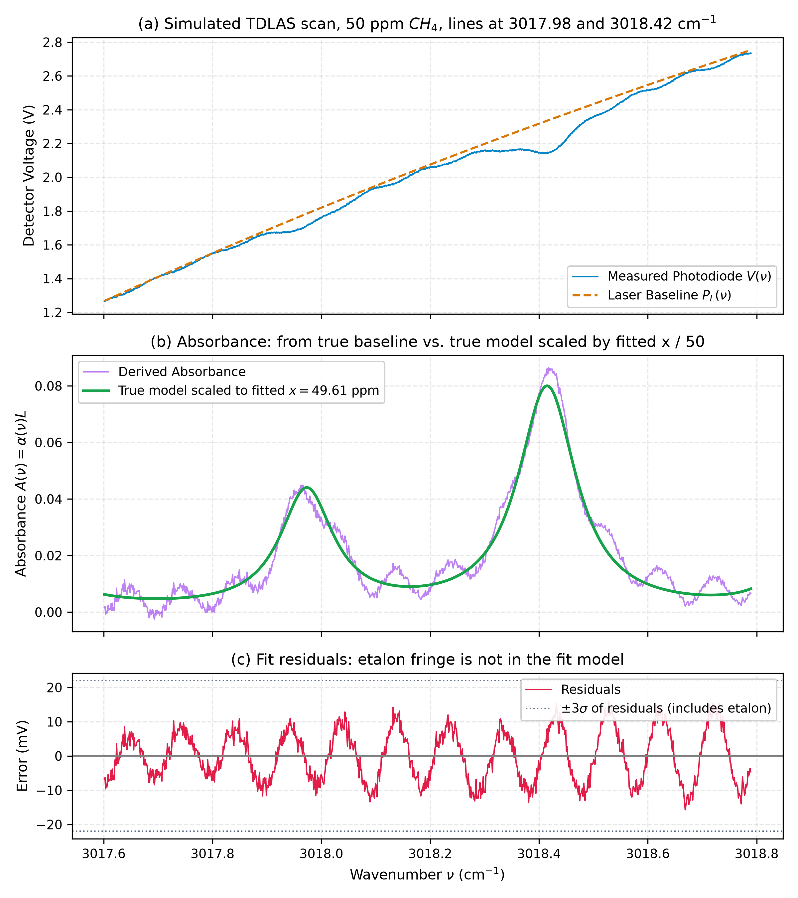
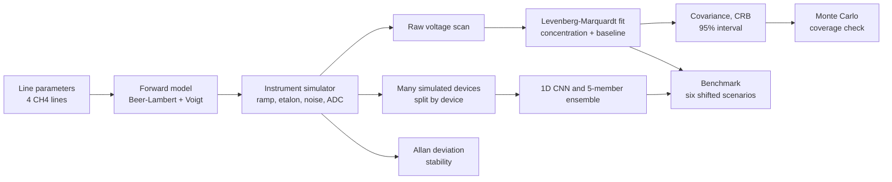
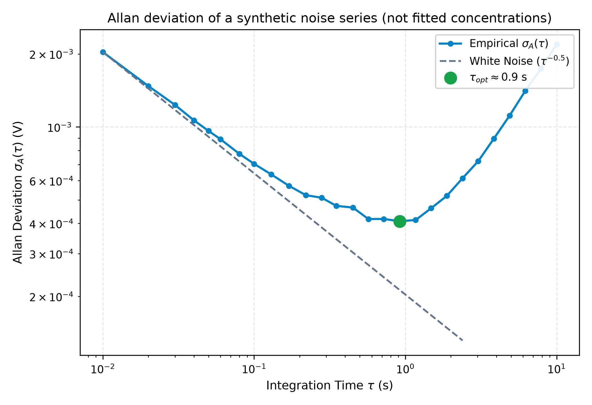
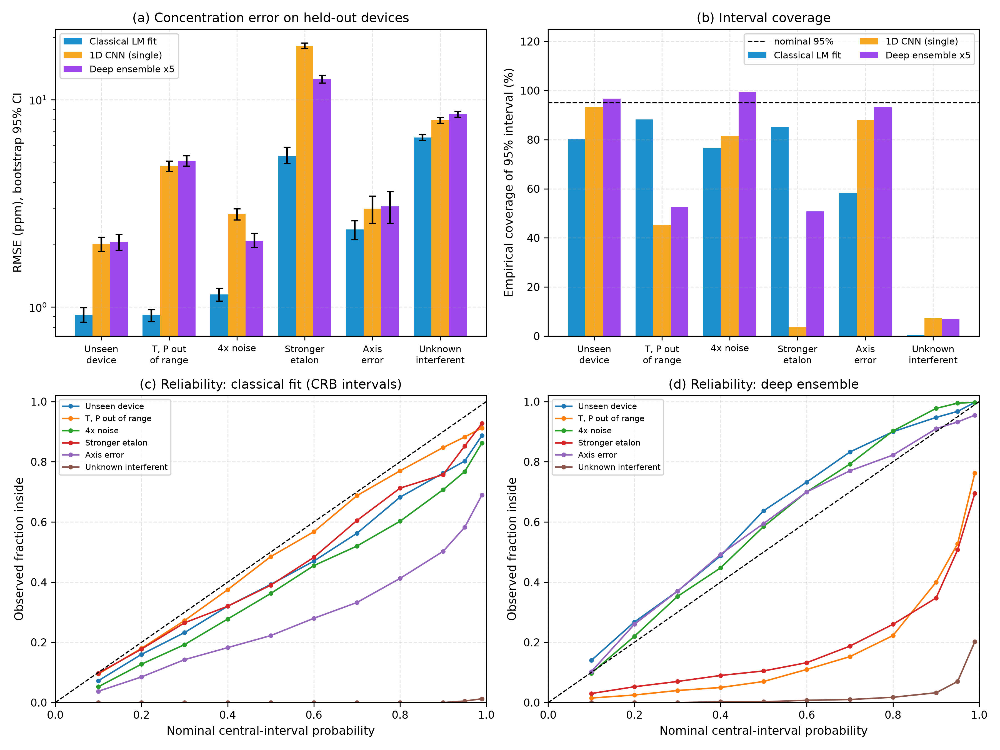

<div align="center">

# TDLAS Methane Retrieval, From Scratch

**Tunable Diode Laser Absorption Spectroscopy (TDLAS) for methane near 3018 cm⁻¹ (3313 nm): a simulated laser sensor, a Voigt / Levenberg-Marquardt retrieval written from first principles, honest uncertainty analysis, and a leakage-free ML-vs-classical benchmark.**

[](pyproject.toml)
[](tests/)
[](#what-is-written-from-scratch)
[](#limitations)
[](#interactive-dashboard-guide)



<sub>One simulated scan at 50 ppm CH₄: detector voltage and laser baseline (top), absorbance (middle) and fit residuals (bottom). The periodic residuals are the etalon fringe, which the fit model deliberately does not include.</sub>

[Highlights](#highlights) · [How it works](#how-it-works) · [Results](#results) · [Limitations](#limitations) · [Run it](#quickstart) · [Dashboard guide](#interactive-dashboard-guide)

</div>

---

## Highlights

| | |
| :--- | :--- |
| **From scratch** | Weideman rational **Faddeeva / Voigt** line shape, **Levenberg-Marquardt** with analytical Jacobian, covariance and **Cramér-Rao** bound, **Allan deviation**, software lock-in, 1D CNN and **deep ensemble** with Gaussian NLL |
| **Checked against libraries** | Faddeeva vs `scipy.special.wofz`: max relative error **1.7 × 10⁻¹⁴**. Fit vs `scipy.optimize.least_squares`: at most **1.2 × 10⁻⁴ ppm** apart on 30 noisy scans |
| **Uncertainty, tested** | White noise only: 95% interval covers **95.2%** of 1000 scans (CRB / scatter = 1.04). Realistic noise (etalon + 1/f + drift): only **76.3%** — the white-noise assumption breaks |
| **ML vs classical** | Split by device (60 / 20 / 20), six shifted scenarios. The classical fit has the **lower RMSE in all six**; the ensemble is **better calibrated** inside its training range and **over-confident** outside it |
| **Reproducible** | Seeded runs, results stored in `docs/results/`, one command per result, a test suite that also checks the stored numbers |
| **Honest** | Everything is simulated, and the [limitations](#limitations) are listed up front |

---

## Why this project

Absorption spectroscopy turns "how much light is missing at the methane lines" into a gas concentration. Doing that well means getting several things right at once: line physics, an instrument with ugly artefacts (laser ramp, etalon fringes, 1/f noise, drift, ADC), a non-linear fit, and an uncertainty you can actually trust.

This repository builds that whole chain on simulated data so that each step can be **tested against a known truth**, and then asks a practical question: *does a neural network beat the physical fit, and when does it stop being trustworthy?*

The setup is inspired by the 2023 Cranfield University work on an Interband Cascade Laser with an integrating-sphere cell (Hodgkinson et al.): a laser near 3313 nm, an effective path of about 70 cm, and a fit over several absorption lines. This is an independent project and is not affiliated with that group.

---

## How it works



### 1. Physics: the forward model

Beer-Lambert absorption through an effective path $L$:

$$I(\nu)=I_0(\nu)\,e^{-A(\nu)},\qquad A(\nu)=L\sum_i S_i(T)\,N\,g_i(\nu-\nu_i),\qquad N=\frac{xP}{k_B T}$$

- Line intensity is scaled with temperature using the partition function $Q(T)$ and the Boltzmann and stimulated-emission factors.
- Line width combines Doppler broadening $\gamma_D$ and pressure broadening $\gamma_L=(T_0/T)^n[\gamma_{air}(P-p_s)+\gamma_{self}\,p_s]$, with a pressure-induced line shift.
- The line shape is a normalised **Voigt** profile, computed from the **Faddeeva function** with Weideman's rational approximation (N = 36), written from scratch.

### 2. The instrument simulator

The detector voltage is built the way a real one behaves:

$$V(t)=P_L\big(i(t)\big)\,\big[1+\epsilon_{et}(t)\big]\,e^{-A(\nu(t))}+n(t)$$

- **Laser ramp:** a 10 ms, 1000-point scan with a slightly non-linear tuning $\nu(t)=\nu_c+a\,t+b\,t^2$, and a quadratic laser power baseline.
- **Etalon:** a sinusoidal fringe $1+m\cos(2\pi\nu/\mathrm{FSR}+\phi)$ of 0.3–1.5%.
- **Noise:** white Gaussian noise, frequency-filtered 1/f noise, and slow random-walk drift.
- **ADC:** 16-bit quantisation over a 0–5 V range.
- **Devices:** every simulated "device" draws its own ramp, power, etalon and noise parameters. This is what makes the leakage-free ML split possible.

### 3. The retrieval: Levenberg-Marquardt, from scratch

The fit estimates the concentration $x$ and a third-order polynomial baseline at the same time:

$$V_{model}=\mathrm{Poly}(t;\,c)\;e^{-A(\nu;\,x)}$$

The damped step solves $(J^\top J+\lambda\,\mathrm{diag}(J^\top J))\,\Delta\theta=-J^\top r$ with the **analytical Jacobian** for $x$ and the baseline coefficients. Baseline coefficients are initialised from the absorption-free wings, and the concentration is kept non-negative.

### 4. Uncertainty you can test

From the same Jacobian, $\mathrm{Cov}(\hat\theta)\approx\sigma^2(J^\top J)^{-1}$ gives the **Cramér-Rao** standard deviation of the concentration and a 95% interval. A Monte Carlo of 1000 scans then checks whether that interval really covers the truth 95% of the time.

### 5. Stability: Allan deviation

Block-averaged Allan deviation shows where averaging stops helping. For pure white noise the log-log slope is −0.5, and the code reproduces −0.503.

### 6. ML against the classical fit

- **Data:** 100 simulated devices × 100 scans, split **by device** into 60 train, 20 validation and 20 test devices. No device appears in two splits.
- **Models:** a 1D CNN that outputs a mean and a log-variance, trained with the **Gaussian negative log-likelihood**, and a 5-member **deep ensemble** (different seeds) whose total variance combines the members' aleatoric variance and their disagreement.
- **Discipline:** validation devices drive early stopping, checkpoints and the learning-rate search. The test devices are used only for the final evaluation.
- **Six shifted scenarios:** unseen device, temperature and pressure out of range, 4× noise, stronger etalon, tuning-axis error, and an unmodelled interfering absorber.
- **Metrics:** RMSE with bootstrap confidence intervals, bias, 95% interval coverage, NLL, gross-error rate, reliability curves and latency.

### What is written from scratch

| Component | From-Scratch Implementation | Validation Reference (library used only for checking) | Measured result |
| :--- | :--- | :--- | :--- |
| Faddeeva function $w(z)$ | Weideman (1994) rational approximation, $N=36$ | `scipy.special.wofz` | Max relative error $1.7\times10^{-14}$ on $|x|\le 50,\ 10^{-4}\le y\le 100$; $9\times10^{-16}$ on the grid that covers the CH4 lines |
| Voigt line shape | Normalised Voigt via $w(z)$ | numerical trapezoid | Area $= 0.9998$ for $\gamma_D=0.015$, $\gamma_L=0.035\ \text{cm}^{-1}$ over a 236 cm$^{-1}$ window |
| Line data | 4 hand-entered CH4 lines in `src/tdlas/data/hitran_ch4_3018.json` | none | **Not downloaded from HITRAN and not verified against it** |
| Partition function $Q(T)$ | A cubic polynomial in `hitran_io.py` | none | Gives $Q(296\,\mathrm{K})=590.4$; **not checked against a TIPS table** at other temperatures |
| Non-linear fit | Levenberg-Marquardt with analytical Jacobian for $x$ and baseline coefficients | `scipy.optimize.least_squares` | Noiseless recovery to $1.2\times10^{-5}$ relative error in 3 iterations |
| Covariance and CRB | $\sigma^2 (J^\top J)^{-1}$ from the fit Jacobian | Monte Carlo | See [Results](#results) |
| Allan deviation | Non-overlapping block averages (`allan.py`) | none | White-noise slope $-0.503$ |
| Software lock-in | Dual-phase demodulation over an integer number of cycles (`hardware/lockin.py`), no low-pass filter | none | Unit-tested on a clean sine only; 2f use **not validated** |
| 1D CNN, Gaussian NLL, deep ensemble | Model, loss and training loop in `src/tdlas/ml/` (optimiser and autograd from PyTorch) | PyTorch | See the ML benchmark below |

---

## Results

All numbers come from seeded runs of the code in this repository: `python scripts/run_validation.py` (stored in [`docs/results/validation.json`](docs/results/validation.json)) and `python scripts/run_ml_benchmark.py` (stored in [`docs/results/ml_benchmark.json`](docs/results/ml_benchmark.json)).

Simulator settings for the Monte Carlo: $T=296\ \mathrm{K}$, $P=1\ \mathrm{atm}$, $L\approx 70\ \mathrm{cm}$, one fixed random device (white noise 2.0 mV, 1/f noise 0.59 mV, etalon 0.35%, random-walk drift of about 5 mV per scan).

### Concentration estimator: bias, spread, CRB and 95% coverage (1000 scans per row)

**White noise only**: the case where the CRB assumptions hold.

| True $x$ | Mean estimate | Std of estimate | Mean CRB std | CRB / std | 95% CI coverage |
| :--- | :--- | :--- | :--- | :--- | :--- |
| 0 ppm | 0.038 | 0.055 | 0.098 | 1.77 | 97.3% |
| 5 ppm | 5.001 | 0.095 | 0.098 | 1.04 | 95.3% |
| 25 ppm | 25.000 | 0.096 | 0.100 | 1.04 | 95.2% |
| 50 ppm | 50.000 | 0.099 | 0.102 | 1.04 | 95.3% |

At 0 ppm the estimate is clamped to $x\ge 0$, which biases the mean upward and breaks the Gaussian assumption.

**Default instrument model**: white noise + 1/f + drift + etalon.

| True $x$ | Mean estimate | Std of estimate | Mean CRB std | CRB / std | 95% CI coverage |
| :--- | :--- | :--- | :--- | :--- | :--- |
| 5 ppm | 5.034 | 0.448 | 0.276 | 0.62 | 77.6% |
| 25 ppm | 25.042 | 0.461 | 0.279 | 0.61 | 76.3% |
| 50 ppm | 50.050 | 0.481 | 0.283 | 0.59 | 75.6% |

With coloured noise and drift, the white-noise CRB underestimates the real scatter by about 40%, and the nominal 95% interval covers about 76%. A noise-budget table (switching noise sources on one at a time) has not been produced yet.

### Allan deviation

<p align="center"></p>

- Pure white noise (20000 samples at 100 Hz): fitted slope over the first 12 points is **−0.503**.
- The figure uses a **hand-built synthetic series** (white noise 2 mV, pink noise 0.8 mV rms, linear drift 0.3 mV/s), not fitted concentrations. Its minimum is 0.41 mV at τ ≈ 0.9 s, and the curve rises afterwards because of the added drift. The axis is in volts, so no detection limit in ppm is derived from it.

### ML vs classical under Distribution Shift (six scenarios)

<p align="center"></p>

Setup: 100 devices × 100 scans, split by device (60 / 20 / 20); training conditions 0–50 ppm, 285–310 K, 0.95–1.05 atm; 400 test scans per scenario on the 20 held-out devices, concentration 5–45 ppm. The classical fit is given the true $T$, $P$, $L$ and (except in "axis error") the true wavenumber axis; the networks see only the voltage trace.

| Scenario (what changes) | LM fit RMSE / 95% cov | CNN RMSE / cov | Ensemble RMSE / cov | LM bias | Ensemble bias |
| :--- | :--- | :--- | :--- | :--- | :--- |
| Unseen device | 0.92 ppm / 80.2% | 2.01 / 93.2% | 2.06 / 96.8% | +0.25 | −0.41 |
| $T$ 330–350 K, $P$ 1.2–1.4 atm | 0.91 / 88.2% | 4.79 / 45.2% | 5.07 / 52.8% | +0.28 | −4.39 |
| 4× noise | 1.15 / 76.8% | 2.81 / 81.5% | 2.08 / 99.5% | +0.25 | +0.10 |
| Etalon amplitude 4–6% (training ≤ 1.5%) | 5.35 / 85.2% | 18.19 / 3.8% | 12.57 / 50.7% | +1.93 | +10.83 |
| Axis error (±0.03 cm⁻¹, ±5% span) | 2.36 / 58.2% | 2.98 / 88.0% | 3.06 / 93.2% | −1.22 | −0.75 |
| Unknown interferent (3 assumed lines) | 6.57 / 0.5% | 7.95 / 7.2% | 8.51 / 7.0% | −6.21 | −8.05 |

What the numbers say:

- The classical fit has the **lower RMSE in all six scenarios**; the ensemble is about 2× worse even on unseen devices inside the training distribution.
- The ensemble is **better calibrated** where data stay inside its training range (93–99.5% coverage for unseen device, 4× noise and axis error, against 58–80% for the classical CRB intervals, which ignore etalon, drift and 1/f noise).
- **Outside the training range** (temperature/pressure, strong etalon) the networks degrade and become **over-confident** (coverage 4–53%).
- An unmodelled interfering absorber breaks both methods.
- CPU batch-1 latency: CNN 0.35 ms, ensemble 1.64 ms, LM fit about 3–3.6 ms.

> **Caveats.** The CNN is small and was tuned over only three learning rates (the best, 3e-4, sits at the edge of the grid), so the gap does not bound what a better-tuned or hybrid network-plus-fit model could do. The interferent lines are placeholders, not real spectroscopic data. This is one seed and one set of 100 simulated devices.

---

## Limitations

> All spectroscopic signals in this repository are generated by the forward simulator in this repository, with assumed (not measured) instrument parameters. **No real optical laboratory, laser or detector data were used, and no hardware experiment was performed.** The results show how the code behaves on simulated data and are not a claim of performance equal to any real sensor.

Known gaps, listed so nobody has to find them:

- **Spectroscopic data:** the 4 CH4 lines and the $Q(T)$ polynomial were entered by hand and not checked against HITRAN or TIPS. Only two lines fall inside the scan window.
- **Wavelength axis:** the fit uses the simulator's true $\nu(t)$. `wavelength_cal.py` can rebuild the axis from etalon fringes but is not wired into the fit, and its error on simulated scans (true anchor, 8 devices) is 0.007–0.048 cm⁻¹, comparable to the line half-width (about 0.06 cm⁻¹).
- **Fit settings:** the fit is given the true $T$, $P$ and $L$, and the etalon is not modelled (it shows up as structured residuals).
- **Uncertainty:** the CRB uses the residual standard deviation and white-noise assumptions; see the coverage tables above.
- **Allan:** computed on a synthetic series, not on fitted concentrations.
- **Lock-in / WMS:** no low-pass filter and no validation of 2f detection. The lock-in figure and dashboard tab use a test signal with no 2f component.
- **ML:** one small CNN architecture, one seed, three learning rates tried, no hybrid variant.
- **Hardware:** only a mock Arduino sketch and an experiment-design document. No physical experiment, data or video.
- **Notebooks** are short and have no saved outputs. There is no PDF report.

---

## Quickstart

```bash
# 1. Install in editable mode (the ML extra needs PyTorch)
pip install -e ".[dev,ml]"

# 2. Run the tests (note: tests/test_export_figures.py rewrites docs/figures/ in --fast mode)
pytest -v

# 3. Reproduce the numerical checks quoted above (about 30 s; rewrites docs/results/validation.json)
python scripts/run_validation.py

# 4. Train the ensemble and run the six-scenario benchmark
#    (about 1-2 minutes on a GPU; rewrites docs/results/ml_benchmark.json and the saved weights)
python scripts/run_ml_benchmark.py

# 5. Print the pipeline run log: one scan fit, white-noise Allan slope, benchmark summary
python scripts/reproduce_all.py          # add --fast for a tiny smoke test

# 6. Launch the interactive dashboard (see the guide below)
python scripts/run_dashboard.py

# 7. Regenerate the figures in docs/figures/ and docs/interactive_report.html
python scripts/export_figures.py
```

| Script | What it does | Writes |
| :--- | :--- | :--- |
| `scripts/run_validation.py` | Faddeeva/Voigt accuracy, fit recovery, comparison with SciPy, Monte Carlo, Allan, axis calibration | `docs/results/validation.json` |
| `scripts/run_ml_benchmark.py` | Trains the CNN and ensemble and evaluates six scenarios | `docs/results/ml_benchmark.json`, `src/tdlas/data/ensemble_ch4.pt` |
| `scripts/reproduce_all.py` | Prints one end-to-end run log (full mode also reruns the benchmark) | `docs/results/ml_benchmark.json` (full mode only) |
| `scripts/export_figures.py` | Draws Figures 1–4 and the static report | `docs/figures/`, `docs/interactive_report.html` |
| `scripts/run_dashboard.py` | Serves the local dashboard | nothing |

Everything runs offline. Training is seeded and asks PyTorch for deterministic GPU kernels; two full runs gave identical results on the development machine. Without a GPU, training falls back to the CPU and takes longer.

---

## Interactive dashboard guide

A small local web app lets you move the instrument and gas parameters and watch the simulation, the fit and the ML comparison respond. It needs no internet connection and no extra front-end tooling.

### Launch

```bash
python scripts/run_dashboard.py
```

It opens `http://127.0.0.1:8050/` in your browser. Useful options:

| Option | Meaning |
| :--- | :--- |
| `--port 8051` | Use another port. If the chosen port is busy, the next free one is used and printed |
| `--host 127.0.0.1` | Interface to bind (default is local only) |
| `--no-browser` | Do not open a browser window automatically |

Stop it with `Ctrl+C`.

### The controls (left panel)

- **Presets:** *Nominal* (50 ppm, 296 K, clean), *Detection Limit* (1 ppm, higher noise), *Etalon Interference* (40 ppm, 3.5% etalon), *High T/P* (60 ppm, 350 K, 1.5 atm).
- **Sliders:** CH₄ concentration (0.1–100 ppm), gas temperature (250–400 K), total pressure (0.5–2.0 atm), white-noise standard deviation (0.5–20 mV) and etalon fringe amplitude (0–5%).
- **Run Inversion:** simulates one scan with the current settings and fits it. **Reset** restores the defaults.

### The four tabs

1. **Spectroscopy & Voigt Fit.** Shows the retrieved concentration against the true one, the Cramér-Rao 1σ uncertainty, the number of Levenberg-Marquardt iterations and latency, and the residual standard deviation. Three charts show the detector voltage with the laser baseline, the absorbance with the fitted line shape, and the fit residuals. Raise the etalon slider and watch the periodic pattern appear in the residuals.
2. **Physics vs ML Side-by-Side.** Runs the Levenberg-Marquardt fit and the **trained 5-member ensemble** on the same simulated scan and shows each estimate, its 95% interval, its error and its latency. A badge says whether your settings are **inside or outside the range the ensemble was trained on** (0–50 ppm, 285–310 K, 0.95–1.05 atm, etalon 0.3–1.5%, noise 1–2.5 mV). Push a slider outside that range and compare how the two methods react. If PyTorch or the weights file is missing, the ML card shows "--".
3. **Allan-Werle Deviation.** Plots the Allan deviation of a hand-built noise series (white + pink + drift) with the −0.5 white-noise reference and its minimum. It illustrates the concept; it is not computed from your fitted concentrations.
4. **WMS Lock-In Demodulation.** Shows the software lock-in output (1f amplitude, 2f amplitude, phase and ratio) for a simulated test signal. That signal contains no 2f component, so the 2f value is the noise floor; the tab demonstrates the demodulation code, not a gas measurement.

### Reading the dashboard correctly

- Each setting simulates **one scan** from a fixed random device and a fixed noise seed, so the same settings always give the same numbers. One scan illustrates a case; the statistics are in the [Results](#results) section.
- The ML panel uses a device that is not one of the benchmark devices, and it shows a single case, not the benchmark.
- The **Export Figures** button only displays a reminder: figures are produced by `python scripts/export_figures.py`.

---

## Repository structure

```
├── README.md
├── pyproject.toml
├── src/tdlas/
│   ├── hitran_io.py          # Line data loader, partition function, S(T)
│   ├── lineshape.py          # Weideman Faddeeva and Voigt profile
│   ├── absorption.py         # Beer-Lambert forward model
│   ├── instrument.py         # Device parameters, laser ramp, etalon, noise, ADC
│   ├── fit.py                # Levenberg-Marquardt with analytical Jacobian
│   ├── uncertainty.py        # Covariance, CRB, coverage, Monte Carlo
│   ├── allan.py              # Allan deviation and the Figure 3 series
│   ├── wavelength_cal.py     # Etalon axis calibration (not used by the fit)
│   ├── validation.py         # The checks run by scripts/run_validation.py
│   ├── dashboard_backend.py  # REST backend and static files for the dashboard
│   ├── static/               # Dashboard front end (HTML, CSS, JS)
│   ├── data/                 # hitran_ch4_3018.json (4 hand-entered lines), ensemble_ch4.pt (trained ensemble)
│   └── ml/                   # dataset.py, model.py, train.py, benchmark.py
├── scripts/                  # run_validation, run_ml_benchmark, reproduce_all, export_figures, run_dashboard
├── hardware/                 # Software lock-in, mock Arduino sketch
├── notebooks/                # Four short pedagogical notebooks
├── docs/
│   ├── technical_report.md   # Report with the measured numbers
│   ├── experiment_design.md  # Design of experiments for real data collection (a plan, not an experiment)
│   ├── interactive_report.html
│   ├── figures/              # Figures 1-4 as PNG and SVG
│   └── results/              # validation.json, ml_benchmark.json
└── tests/                    # 22 test files, including checks on the stored results
```

---

## References

1. Hodgkinson, J. et al. (2023). Cranfield University methane sensor work (ICL, integrating sphere cell). Cited for inspiration only; the exact title and details have not been re-checked here.
2. Rothman, L. S. et al. (2020). The HITRAN2020 molecular spectroscopic database. JQSRT 277, 107949. (The line parameters in this repository are *not* taken from it.)
3. Weideman, J. A. C. (1994). Computation of the Complex Error Function. SIAM J. Numer. Anal. 31(5), 1497–1518.
4. Werle, P., Mücke, R., Slemr, F. (1993). The limits of signal averaging in atmospheric trace-gas monitoring by tunable diode-laser absorption spectroscopy (TDLAS). Appl. Phys. B 57, 131–139. (Title to be re-verified.)
5. Lakshminarayanan, B., Pritzel, A., Blundell, C. (2017). Simple and Scalable Predictive Uncertainty Estimation using Deep Ensembles. NeurIPS 2017.
